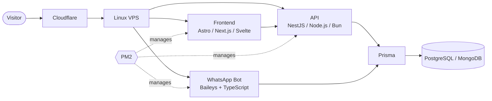

<div align="center">

# Syaiful Rohman


[](https://t.me/bang_syaii)
[](https://bang.syaii.sbs)
[](https://github.com/LT-SYAII)

```bash
syaii@bang:~$ whoami
> Full Stack Developer & System Architect — Indonesia
```

</div>

---

## `$ neofetch`

```
.-------------------.    syaii@bang
| $ bun run dev     |    ----------
|                   |    Name      : Syaiful Rohman (Bang Syaii)
| > ready           |    Role      : Full Stack Developer & System Architect
| > localhost:4321  |    Location  : Indonesia
|                   |    Uptime    : 3+ years coding
| $ _               |    Framework : Astro (go-to), React, Next.js, Svelte
'-------------------'    Styling   : Tailwind CSS
                         Language  : TypeScript, JavaScript
                         Backend   : Node.js, NestJS, Bun
                         Database  : PostgreSQL, MongoDB, Prisma
                         Infra     : Linux VPS, PM2, Cloudflare
                         Focus     : Web apps, APIs, WhatsApp bots
                         Status    : Freelance, open for UMKM website projects
                         Contact   : t.me/bang_syaii
```

## `$ cat about.ts`

<table>
<tr>
<td width="240" align="center"></td>
<td>

```typescript
const syaii = {
  name: "Syaiful Rohman",
  alias: "Bang Syaii",
  roles: ["Full Stack Developer", "System Architect"],
  location: "Indonesia",
  experience: "3+ years",
  freelance: { focus: "UMKM websites", open: true },
  favorite: "Astro",
  stack: {
    frontend: ["Astro", "React", "Next.js", "Svelte", "Tailwind CSS"],
    backend: ["Node.js", "NestJS", "Bun"],
    database: ["PostgreSQL", "MongoDB", "Prisma"],
    infra: ["Linux VPS", "PM2", "Cloudflare"],
    also: ["Go", "Kotlin", "Dart/Flutter", "Zig", "Baileys"],
  },
} as const;
```

</td>
</tr>
</table>

## `$ ls ~/stack`

**frontend/**


**backend/**


**database/**


**infra/**


**lainnya/**


## `$ how-i-build --typical`

How a typical project fits together, from the browser down to the server:



## `$ cat code-samples/*`

A few snippets in the languages I write most. Open the ones you want to read.

<details>
<summary><b>Astro</b>: pages and components (my default for sites)</summary>

```astro
---
// src/pages/index.astro
import Layout from "../layouts/Layout.astro";
import ServiceCard from "../components/ServiceCard.astro";

const services = [
  { title: "Business Website", desc: "Fast and SEO-friendly" },
  { title: "Dashboard", desc: "Admin panels and internal tools" },
];
---

<Layout title="Studio">
  <section class="grid gap-6 md:grid-cols-2">
    {services.map((service) => <ServiceCard {...service} />)}
  </section>
</Layout>
```

</details>

<details>
<summary><b>TypeScript + NestJS</b>: controllers and DTOs</summary>

```typescript
@Controller("projects")
export class ProjectsController {
  constructor(private readonly projects: ProjectsService) {}

  @Get()
  findAll(@Query("take") take = "10") {
    return this.projects.findAll(Number(take));
  }

  @Post()
  create(@Body() dto: CreateProjectDto) {
    return this.projects.create(dto);
  }
}
```

</details>

<details>
<summary><b>TypeScript + Baileys</b>: WhatsApp bot command handler</summary>

```typescript
import makeWASocket, { useMultiFileAuthState } from "@whiskeysockets/baileys";

const { state, saveCreds } = await useMultiFileAuthState("session");
const sock = makeWASocket({ auth: state });

const commands = new Map<string, (jid: string, text: string) => Promise<void>>();
commands.set("ping", async (jid) => {
  await sock.sendMessage(jid, { text: "pong!" });
});

sock.ev.on("messages.upsert", async ({ messages }) => {
  for (const msg of messages) {
    const text = msg.message?.conversation ?? "";
    const jid = msg.key.remoteJid;
    if (!jid || !text.startsWith("!")) continue;

    const [cmd, ...args] = text.slice(1).trim().split(/\s+/);
    const handler = commands.get(cmd);
    if (handler) await handler(jid, args.join(" "));
  }
});

sock.ev.on("creds.update", saveCreds);
```

</details>

<details>
<summary><b>Prisma</b>: schema design</summary>

```prisma
model Client {
  id        String    @id @default(cuid())
  name      String
  projects  Project[]
  createdAt DateTime  @default(now())
}

model Project {
  id       String @id @default(cuid())
  title    String
  clientId String
  client   Client @relation(fields: [clientId], references: [id])
}
```

</details>

<details>
<summary><b>Svelte</b>: reactive components</summary>

```svelte
<script lang="ts">
  let count = $state(0);
  let doubled = $derived(count * 2);
</script>

<button onclick={() => count++}>
  Clicked {count} times (doubled: {doubled})
</button>
```

</details>

<details>
<summary><b>Bun</b>: a tiny HTTP server</summary>

```typescript
Bun.serve({
  port: 3000,
  fetch(req) {
    const { pathname } = new URL(req.url);
    if (pathname === "/health") return Response.json({ status: "ok" });
    return new Response("Not found", { status: 404 });
  },
});
```

</details>

<details>
<summary><b>Bash + PM2</b>: deploying to my VPS</summary>

```bash
#!/usr/bin/env bash
set -euo pipefail

git pull --ff-only
bun install --frozen-lockfile
bun run build

pm2 startOrReload ecosystem.config.cjs --env production
pm2 save
```

</details>

## `$ cat services.txt`

| Service | Details |
| --- | --- |
| Business websites | Fast, SEO-friendly sites for UMKM and personal brands |
| Backend & APIs | REST APIs with Node.js, NestJS, and Prisma |
| Dashboards | Admin panels and internal tools |
| WhatsApp bots | Custom bots with Baileys — command, automation, integrasi |
| Server setup | VPS configuration, deployment, and process management |

<div align="center">


</div>

## `$ ./contact.sh`

```bash
telegram="t.me/bang_syaii"
github="github.com/LT-SYAII"
website="bang.syaii.sbs"
```

<div align="center">


</div>

<div align="center">

```bash
syaii@bang:~$ echo "Got a project in mind? Let's build it."
```

</div>
